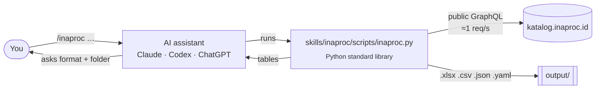

<div align="center">

# 🇮🇩 inaproc

### Search Indonesia's government e-catalogue from your AI assistant

Find products, the cheapest offers, seller scores and TKDN/PDN data on **[katalog.inaproc.id](https://katalog.inaproc.id)**, and export to Excel, CSV, JSON or YAML. It uses public data only, with no login and no API key.

[](https://www.python.org/downloads/)
[](#-requirements)
[](LICENSE)
[](#claude-code)
[](#claudeai--claude-desktop)
[](#codex)
[](#chatgpt)

[**Quick start**](#-quick-start) · [**Features**](#-features) · [**Install**](#-installation) · [**Usage**](#-usage) · [**Exports**](#-output-files) · [**CLI**](#-command-line-reference) · [**FAQ**](#-faq)

</div>

---

## ✨ What it looks like

> **You:** `/inaproc` cheapest A4 80 gram HVS paper, save it as an Excel file in this project
>
> **Assistant:** Which format do you want: chat only, JSON, CSV, XLSX or YAML? And where should I save it: this project (`./output/`) or another folder?
>
> **You:** XLSX, this project
>
> **Assistant:** The cheapest matching offer is **Kertas HVS A4 80 gram from RAKA KENCANA at Rp48.000** (incl. PPN, TKDN+BMP 84.83%, 1,200 sold). Check the unit on the detail page before ordering.
>
> | # | Product | Price (incl. PPN) | Seller | TKDN+BMP | Sold |
> |---|---|---|---|---|---|
> | 1 | Kertas HVS A4 80 gram | Rp48.000 | RAKA KENCANA | 84.83% | 1200 |
> | 2 | Kertas HVS A4 80 Gram | Rp49.950 | PRISAI MIANIS | – | 200 |
> | 3 | KERTAS HVS SIDU A4 80 GRAM KONSOLIDASI | Rp53.280 | TRIAS SARANA GLOBAL | 84.83% | 0 |
>
> Saved: `output/cheapest_kertas-hvs-a4-80-gram_20261123-101500.xlsx`

<sub>Real catalogue data from 23 Nov 2026; prices change.</sub>

---

## 🚀 Quick start

**macOS / Linux**, for Claude Code:

```bash
curl -fsSL https://raw.githubusercontent.com/bahrulbangsawan/inaproc/main/install.sh | bash -s claude
```

**Windows (PowerShell)**, for Claude Code:

```powershell
& ([scriptblock]::Create((irm https://raw.githubusercontent.com/bahrulbangsawan/inaproc/main/install.ps1))) claude
```

Replace `claude` with `codex` for Codex, or `all` for Claude Code + Codex + a zip for Claude.ai. Then restart your assistant and type **`/inaproc`** or just ask about INAPROC products.

> [!TIP]
> On **Claude.ai**, **Claude Desktop** or **ChatGPT** there's nothing to install on your computer. See [Claude.ai](#claudeai--claude-desktop) and [ChatGPT](#chatgpt).

---

## 🧭 Features

| | Feature | What you get |
|---|---|---|
| 🔎 | **Search** | Keyword search with filters: barang / jasa / digital, PDN label, UMKK / official / OAP sellers, price range, category, one seller's products; sort by relevance, price, sales, TKDN, stock or newest |
| 💸 | **Cheapest** | The cheapest *matching* products. Placeholder listings (Rp1, Rp2), per-sheet prices and unrelated items are set aside and reported separately |
| 📄 | **Product detail** | Price incl. PPN, unit and minimum order, every variant with stock, wholesale tiers, TKDN/BMP certificate and expiry, PDN origin, specifications, weight |
| ⚖️ | **Compare** | Two or more products side by side, with the lowest price flagged and a verdict |
| 🏪 | **Seller** | Company profile, address, UMKK status, performance score breakdown (response rate, accepted and completed orders), best-selling products |
| ⭐ | **Reviews** | Rating summary and buyer reviews with the buying agency (KLPD / Satker) |
| 🗂 | **Reference data** | Category tree, provinces and cities with area codes, KBLI codes, PPN rates |
| 💾 | **Exports** | **XLSX, CSV, JSON, YAML** in an `output/` folder; the assistant asks for the format and location first |
| 🛡 | **Polite networking** | About 1 request/second, bounded concurrency, automatic backoff on rate limits |
| 🕵️ | **Zero installs** | Chrome-style request headers, and a `discover` mode that drives your own Chrome to re-capture the API if the site changes |

### How it works



The skill teaches the assistant *when* and *how* to use the catalogue, and the bundled script does the work: it sends the same public requests the website's search page sends, then formats the results.

---

## 📋 Requirements

| Platform | You need |
|---|---|
| **Claude Code** (macOS · Linux · Windows) | **Python 3.8+** |
| **Codex** CLI / IDE | **Python 3.8+** |
| **Claude.ai / Claude Desktop** | Nothing. It runs in Claude's sandbox. Turn on code execution and allow network access to `katalog.inaproc.id`. |
| **ChatGPT** | Nothing. It runs as a Custom GPT Action. |

No `pip install` is needed. The script, including its XLSX and YAML writers, uses only Python's standard library.

<details>
<summary><b>How do I check or install Python?</b></summary>

<br>

| OS | Check | Install |
|---|---|---|
| macOS | `python3 --version` | The first `python3` run offers Apple's Command Line Tools (includes Python 3.9), or `brew install python` |
| Windows | `py --version` | `winget install Python.Python.3.12`, or [python.org](https://www.python.org/downloads/). Tick **"Add python.exe to PATH"**. |
| Linux | `python3 --version` | Usually preinstalled; otherwise `sudo apt install python3` (Debian/Ubuntu) or your distro's package |

</details>

<details>
<summary><b>Optional extras</b></summary>

<br>

| Extra | Adds | Install |
|---|---|---|
| Chrome, Chromium, Edge or Brave | The `discover` maintenance command and the `penyedia` seller commands | Found automatically, or point `--chrome-path` / `INAPROC_CHROME` at it |

</details>

---

## 📦 Installation

### Claude Code

<table>
<tr><td><b>One line</b></td><td>

```bash
curl -fsSL https://raw.githubusercontent.com/bahrulbangsawan/inaproc/main/install.sh | bash -s claude
```

</td></tr>
<tr><td><b>From a clone</b></td><td>

```bash
git clone https://github.com/bahrulbangsawan/inaproc.git
cd inaproc
./install.sh claude      # all projects (~/.claude/skills/inaproc, respects $CLAUDE_CONFIG_DIR)
./install.sh project     # only the current project (./.claude/skills/inaproc)
```

</td></tr>
<tr><td><b>By hand</b></td><td>

Copy `skills/inaproc/` to `~/.claude/skills/inaproc/`.

</td></tr>
</table>

Start a new Claude Code session and type `/inaproc`. The installer finishes with a live check that the catalogue is reachable.

### Claude.ai / Claude Desktop

1. Download **`inaproc.zip`** from the [latest release](https://github.com/bahrulbangsawan/inaproc/releases/latest), or build it with `./install.sh zip`.
2. Go to **Settings → Capabilities**, turn on **Code execution and file creation**, and allow network egress to **`katalog.inaproc.id`** (or all domains).
3. Go to **Settings → Capabilities → Skills → Upload skill** and choose `inaproc.zip`.
4. In any chat, ask: *"cari laptop PDN termurah di INAPROC di bawah 15 juta, simpan sebagai xlsx"*.

Exported files appear in the chat for download.

### Codex

```bash
curl -fsSL https://raw.githubusercontent.com/bahrulbangsawan/inaproc/main/install.sh | bash -s codex
# or, from a clone:  ./install.sh codex
```

This installs the skill to `~/.codex/skills/inaproc/` (respects `$CODEX_HOME`) and a slash prompt to `~/.codex/prompts/inaproc.md`. Restart Codex, then use **`/prompts:inaproc …`**, mention `$inaproc`, or just ask. If your Codex sandbox blocks the network, allow it for `katalog.inaproc.id`.

### ChatGPT

ChatGPT can't run local scripts, so it uses a **Custom GPT with an Action** that calls the same public API:

1. Go to **ChatGPT → Explore GPTs → Create → Configure**.
2. **Instructions**: paste [`chatgpt/instructions.md`](chatgpt/instructions.md).
3. **Capabilities**: turn on **Code Interpreter & Data Analysis**, which the file exports need.
4. **Actions → Create new action → Import from text**: paste [`chatgpt/openapi.yaml`](chatgpt/openapi.yaml). Authentication: **None**.
5. Save, and chat with your GPT. Publishing it publicly requires a privacy-policy URL of your own.

### Windows

```powershell
# one line
& ([scriptblock]::Create((irm https://raw.githubusercontent.com/bahrulbangsawan/inaproc/main/install.ps1))) claude
# from a clone
.\install.ps1 claude     # or: project | codex | zip | all | uninstall
```

If PowerShell blocks the script: `powershell -ExecutionPolicy Bypass -File .\install.ps1 claude`.

### Update or uninstall

```bash
./install.sh claude       # re-running updates in place (same for codex)
./install.sh uninstall    # removes the Claude Code and Codex installs
```

---

## 💬 Usage

Just talk to your assistant. Indonesian and English both work.

| Ask | What happens |
|---|---|
| `/inaproc cari kertas HVS A4 PDN di bawah 60 ribu` | Filtered search |
| `/inaproc cheapest laptop core i5 with TKDN` | Relevance-ranked, then price-ranked, with outliers set aside |
| `/inaproc detail https://katalog.inaproc.id/anak-terusan/kertas-hvs` | Full product sheet |
| `/inaproc compare <url1> <url2> <url3>` | Side-by-side table and verdict |
| `/inaproc siapa penyedia sinzo-mitra-sejati? tampilkan produk terlarisnya` | Seller profile, score and best sellers |
| `/inaproc reviews for <url>` | Rating summary and buyer reviews |
| `/inaproc list the jasa categories` | Category tree with IDs |
| `/inaproc ini file RAB ./RAB.xlsx, ini link perusahaan saya <url>, carikan pembanding minimal 2` | Asks *win* (company stays cheapest, comparisons cost more) or *cheapest*, then builds the one-sheet **Perbandingan** workbook with every product link |

Before fetching anything, the assistant asks you for the **output format** (chat only · JSON · CSV · XLSX · YAML) and the **save location** (this project → `./output/`, or another folder). Answer once per request, or say it upfront: *"…save as csv in ~/Documents"*.

---

## 💾 Output files

Files are written to `<folder>/output/`, and the folder is created if needed:

```
output/
├── compare_anak-terusan-vs-sinzo-mitra-sejati_20261123-101500.xlsx          ← one sheet per table
├── compare_anak-terusan-vs-sinzo-mitra-sejati_20261123-101500__products.csv ← one CSV per table
├── compare_anak-terusan-vs-sinzo-mitra-sejati_20261123-101500__variants.csv
├── compare_anak-terusan-vs-sinzo-mitra-sejati_20261123-101500.json          ← full data + meta
└── compare_anak-terusan-vs-sinzo-mitra-sejati_20261123-101500.yaml
```

| Format | Structure | Best for |
|---|---|---|
| **XLSX** | One workbook, one sheet per table, bold frozen header | Procurement worksheets, sharing |
| **CSV** | One UTF-8 file per table (with BOM, so Excel shows Indonesian text correctly) | Spreadsheets, BI tools |
| **JSON** | Complete nested data plus `meta` (source, command, query, timestamp) | Code, pipelines |
| **YAML** | Same as JSON, human-readable | Config, review |

| Command | Tables |
|---|---|
| `search`, `cheapest` | products (+ `set_aside` for cheapest) |
| `detail`, `compare` | products · variants · specifications · wholesale · images |
| `seller` | seller · score_breakdown · products |
| `reviews` | summary · reviews |
| everything else | one table |

---

## 🛠 Command-line reference

The script also works on its own, without an assistant:

```bash
S=~/.claude/skills/inaproc/scripts/inaproc.py

python3 $S search "kertas hvs a4" --type barang --label PDN --max-price 60000
python3 $S cheapest "laptop core i5" --pages 2 --top 10 --save xlsx,csv --out-dir .
python3 $S detail anak-terusan/kertas-hvs --save json --out-dir ~/Documents
python3 $S compare seller-a/product-x seller-b/product-y --save xlsx --out-dir .
python3 $S seller sinzo-mitra-sejati --products 10
python3 $S search --seller-id 01K2KD1FCK4CX04NRKXJ29F7E9 --pages 3 --per-page 60
python3 $S categories --type jasa --depth 2
python3 $S --help                      # all commands;  <command> --help for options
```

<details>
<summary><b>All commands</b></summary>

<br>

| Command | Purpose | Key options |
|---|---|---|
| `search [words]` | Product search | `--type barang\|jasa\|digital` `--label PDN` `--seller-type umkk\|official\|oap` `--min-price` `--max-price` `--category ID` `--seller-id ID` `--sort relevance\|price-asc\|price-desc\|sold\|tkdn\|stock\|newest` `--page` `--pages` `--per-page` |
| `cheapest <words>` | Cheapest matching products | `--pages` `--top` `--strict` `--include-outliers` `--outlier-ratio` + search filters |
| `detail <url>` | One product in full | `--region` |
| `compare <url> <url> …` | Side-by-side | `--region` |
| `read-xlsx <file>` | Print a local .xlsx (e.g. a RAB) | `--sheet`, `--max-rows`, `--json` |
| `rab-report <spec.json>` | RAB comparison → one-sheet `Perbandingan` workbook ([spec](skills/inaproc/references/rab-comparison.md)) | `--mode win\|cheapest`, `--verify` |
| `reviews <url>` | Ratings and reviews | `--page` `--per-page` |
| `seller <slug\|url>` | Seller profile and score | `--products N` |
| `sellers <words>` | Seller search | `--page` `--per-page` |
| `categories` | Category tree | `--type` `--depth 1-3` |
| `category <id>` | One category and its parents | |
| `regions` | Provinces, or cities of `--province CODE` | |
| `region-search <name>` | Find an area code | `--level` |
| `kbli` · `ppn` | KBLI codes · PPN rates | |
| `raw <op> --vars JSON` · `ops` | Any bundled public GraphQL operation | |
| `engine` | Shows the HTTP engine and limits in use | |
| `discover [urls]` | Re-capture the site's API in a stealth browser | `--headed` `--wait S` `--update-queries` `--chrome-path` |

**Options available on every command:** `--json` · `--save json,csv,xlsx,yaml` · `--out-dir DIR` · `--proxy URL` · `--min-interval S` · `--concurrency 1-4`

**Environment variables:** `INAPROC_ENGINE`, `INAPROC_PROXY`, `INAPROC_MIN_INTERVAL`, `INAPROC_CHROME`

</details>

<details>
<summary><b>Network engine and Chrome</b></summary>

<br>

| Capability | How |
|---|---|
| Session management (cookies, keep-alive) | ✅ built in |
| Browser-style headers | ✅ Chrome's header set and order, matching User-Agent (TLS fingerprint stays Python's) |
| Concurrent requests (rate-limited) | ✅ `--concurrency 1-4` |
| Your own proxy | ✅ `--proxy` |
| Background API capture · dynamic loading · tracker blocking | ✅ `discover`, driving your own Chrome over the DevTools Protocol |

Removed in v1.1: the optional Scrapling engine. `--engine scrapling`, `--impersonate` and `--http3` are still accepted but only print a warning.

`discover` is a maintenance tool. If the site changes and a command breaks, re-capture the live GraphQL calls:

```bash
python3 $S discover --headed --wait 60 --update-queries   # click around in the window that opens
```

**Deliberately left out:** CAPTCHA/Turnstile solving and proxy rotation for getting around rate limits. The public API needs neither.

</details>

---

## 📖 Glossary

| Term | Meaning |
|---|---|
| **PPN** | Indonesian VAT (usually 12%); the prices shown include it |
| **TKDN** | *Tingkat Komponen Dalam Negeri*, local-content percentage |
| **BMP** | *Bobot Manfaat Perusahaan*, company-benefit bonus added to TKDN |
| **PDN** | *Produk Dalam Negeri*, made in Indonesia |
| **UMKK** | Micro, small or cooperative business |
| **OAP** | *Orang Asli Papua* seller |
| **Penyedia** | Seller / vendor |
| **KLPD / Satker** | Government institution / work unit (the buyer) |
| **KBLI** | Indonesian business classification code |

---

## ❓ FAQ

<details>
<summary><b>Do I need an INAPROC account?</b></summary>
<br>
No. The skill only uses the catalogue's public, no-login data: products, prices, sellers, reviews and categories. Cart, negotiation, orders and payments need a government account and aren't supported.
</details>

<details>
<summary><b>Why not just sort the website by price?</b></summary>
<br>
The site's price sort puts placeholder listings (Rp1, Rp2), per-sheet prices and unrelated items first. <code>cheapest</code> takes the most relevant results, ranks them by price and lists the suspicious ones separately, so the answer is the cheapest <i>real match</i>. Always check the unit (rim, box, pcs) before deciding.
</details>

<details>
<summary><b>I get "HTTP 503" or "rate-limiting".</b></summary>
<br>
The catalogue's CDN slows down bursts. Wait a minute, then use <code>--min-interval 2 --concurrency 1</code>. The tool already retries with backoff, and pushing harder won't help.
</details>

<details>
<summary><b>I get a network error on Claude.ai / Claude Desktop / Codex.</b></summary>
<br>
The sandbox blocks the internet. Allow network access to <code>katalog.inaproc.id</code> in the app's settings (Claude: Settings → Capabilities; Codex: sandbox network permission).
</details>

<details>
<summary><b>A command broke after a site update.</b></summary>
<br>
The catalogue's API is internal and can change. Run <code>discover --headed --wait 60 --update-queries</code>, compare <code>queries.discovered.json</code> with <code>queries.json</code>, and open an issue or PR.
</details>

---

## 🗂 Repository layout

```
inaproc/
├── skills/inaproc/            ← the skill (this folder is what gets installed)
│   ├── SKILL.md               ← instructions the assistant follows
│   ├── scripts/inaproc.py     ← standard-library CLI
│   ├── scripts/queries.json   ← the 22 public GraphQL operations
│   └── references/api.md      ← request format, variables, enums, fields
├── codex/prompts/inaproc.md   ← /prompts:inaproc for Codex
├── chatgpt/                   ← Custom GPT: instructions, OpenAPI action, queries
├── install.sh · install.ps1   ← installers (macOS/Linux · Windows)
└── LICENSE
```

---

## ⚖️ Disclaimer

This is an **unofficial** community tool. It isn't affiliated with, endorsed by or connected to **LKPP** or **INAPROC**. It reads only information the public website already shows, at a modest request rate. Prices, stock and seller data come straight from the catalogue at the time you ask; always confirm on [katalog.inaproc.id](https://katalog.inaproc.id) before making a procurement decision. Respect the site's terms of use.

## 📄 License

[MIT](LICENSE). Contributions, issues and PRs are welcome.

<div align="center">
<sub>Made for Indonesian procurement teams, analysts and anyone comparing <i>harga e-katalog</i>.</sub>
</div>
