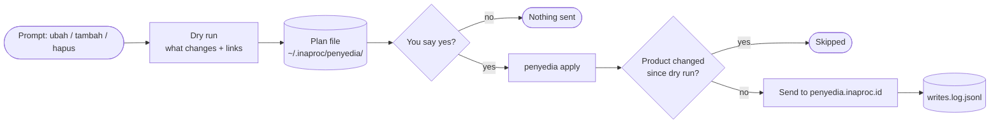

<div align="center">

# 🇮🇩 inaproc

### Search Indonesia's government e-catalogue — and manage your own penyedia products — from your AI assistant

Find products, the cheapest offers, seller scores and TKDN/PDN data on **[katalog.inaproc.id](https://katalog.inaproc.id)**, build RAB price comparisons, and export to Excel, CSV, JSON or YAML — public data, no login, no API key. Sellers can also list, add, update and delete **their own** products on **penyedia.inaproc.id** and see which categories their KBLI allows, through their own signed-in Safari, with every change shown as a dry run first.

[](https://www.python.org/downloads/)
[](#-requirements)
[](LICENSE)
[](#claude-code)
[](#claudeai--claude-desktop)
[](#codex)
[](#chatgpt)

[**Quick start**](#-quick-start) · [**Features**](#-features) · [**Install**](#-installation) · [**Contoh prompt**](#-usage--contoh-prompt) · [**Penyedia**](#-your-own-penyedia-account) · [**Exports**](#-output-files) · [**CLI**](#-command-line-reference) · [**FAQ**](#-faq)

</div>

---

## ✨ What it looks like

> **You:** `/inaproc` cheapest A4 80 gram HVS paper, save it as an Excel file in this project
>
> **Assistant:** Which format do you want: chat only, JSON, CSV, XLSX or YAML? And where should I save it: this project (`./output/`) or another folder?
>
> **You:** XLSX, this project
>
> **Assistant:** The cheapest matching offer is **Kertas HVS A4 80 gram from RAKA KENCANA at Rp48.000** (incl. PPN, TKDN+BMP 84.83%, 1,200 sold). Check the unit on the detail page before ordering.
>
> | # | Product | Price (incl. PPN) | Seller | TKDN+BMP | Sold |
> |---|---|---|---|---|---|
> | 1 | Kertas HVS A4 80 gram | Rp48.000 | RAKA KENCANA | 84.83% | 1200 |
> | 2 | Kertas HVS A4 80 Gram | Rp49.950 | PRISAI MIANIS | – | 200 |
> | 3 | KERTAS HVS SIDU A4 80 GRAM KONSOLIDASI | Rp53.280 | TRIAS SARANA GLOBAL | 84.83% | 0 |
>
> Saved: `output/cheapest_kertas-hvs-a4-80-gram_20261123-101500.xlsx`

<sub>Real catalogue data from 23 Nov 2026; prices change.</sub>

---

## 🚀 Quick start

**macOS / Linux**, for Claude Code:

```bash
curl -fsSL https://raw.githubusercontent.com/bahrulbangsawan/inaproc/main/install.sh | bash -s claude
```

**Windows (PowerShell)**, for Claude Code:

```powershell
& ([scriptblock]::Create((irm https://raw.githubusercontent.com/bahrulbangsawan/inaproc/main/install.ps1))) claude
```

Replace `claude` with `codex` for Codex, or `all` for Claude Code + Codex + a zip for Claude.ai. Then restart your assistant and type **`/inaproc`** or just ask about INAPROC products.

> [!TIP]
> On **Claude.ai**, **Claude Desktop** or **ChatGPT** there's nothing to install on your computer. See [Claude.ai](#claudeai--claude-desktop) and [ChatGPT](#chatgpt).

---

## 🧭 Features

| | Feature | What you get |
|---|---|---|
| 🔎 | **Search** | Keyword search with filters: barang / jasa / digital, PDN label, UMKK / official / OAP sellers, price range, category, one seller's products; sort by relevance, price, sales, TKDN, stock or newest |
| 💸 | **Cheapest** | The cheapest *matching* products. Placeholder listings (Rp1, Rp2), per-sheet prices and unrelated items are set aside and reported separately |
| 📄 | **Product detail** | Price incl. PPN, unit and minimum order, every variant with stock, wholesale tiers, TKDN/BMP certificate and expiry, PDN origin, specifications, weight |
| ⚖️ | **Compare** | Two or more products side by side, with the lowest price flagged and a verdict |
| 🏪 | **Seller** | Company profile, address, UMKK status, performance score breakdown (response rate, accepted and completed orders), best-selling products |
| ⭐ | **Reviews** | Rating summary and buyer reviews with the buying agency (KLPD / Satker) |
| 🗂 | **Reference data** | Category tree, provinces and cities with area codes, KBLI codes, PPN rates |
| 🧾 | **RAB comparison (Perbandingan)** | Reads your RAB `.xlsx`, finds at least two comparison products per line on the catalogue, and builds the one-sheet **Perbandingan** workbook with every product link — mode *menang* (your company stays cheapest) or *termurah* |
| 📑 | **Read Excel files** | Prints a local `.xlsx` (e.g. a RAB) without any extra packages |
| 💾 | **Exports** | **XLSX, CSV, JSON, YAML** in an `output/` folder; the assistant asks for the format and location first |
| 🛡 | **Polite networking** | About 1 request/second, bounded concurrency, automatic backoff on rate limits |
| 🏬 | **Your products (penyedia)** | List and inspect the products in **your** penyedia.inaproc.id account, through your own signed-in Safari (macOS) |
| 🏷 | **Eligible categories by KBLI** | Every category your company's KBLI allows — the same check as the add-product form's *"Anda tidak memiliki KBLI yang sesuai"* — split into Level 1 › Level 2 › Level 3, exportable to CSV/XLSX/JSON/YAML |
| ✏️ | **Add · update · bulk-update · delete** | Add a product (copy of one of yours, saved as a draft), change price/stock/name, update many products from a CSV/XLSX, delete products. Every change is a **dry run you approve**, then `penyedia apply` sends exactly that plan and logs it |
| 🕵️ | **Zero installs** | Chrome-style request headers, and a `discover` mode that drives your own Chrome to re-capture the API if the site changes |

### How it works


The skill teaches the assistant *when* and *how* to use the catalogue, and the bundled script does the work: it sends the same public requests the website's search page sends, then formats the results.

---

## 📋 Requirements

| Platform | You need |
|---|---|
| **Claude Code** (macOS · Linux · Windows) | **Python 3.8+** |
| **Codex** CLI / IDE | **Python 3.8+** |
| **Claude.ai / Claude Desktop** | Nothing. It runs in Claude's sandbox. Turn on code execution and allow network access to `katalog.inaproc.id`. |
| **ChatGPT** | Nothing. It runs as a Custom GPT Action. |
| **Penyedia commands** (your own seller account) | Claude Code or Codex on **macOS** with **Safari** (one setting, see [below](#-your-own-penyedia-account)), or Chrome/Chromium on other systems. Not available on Claude.ai or ChatGPT, because they need your own signed-in browser. |

No `pip install` is needed. The script, including its XLSX and YAML writers, uses only Python's standard library.

<details>
<summary><b>How do I check or install Python?</b></summary>

<br>

| OS | Check | Install |
|---|---|---|
| macOS | `python3 --version` | The first `python3` run offers Apple's Command Line Tools (includes Python 3.9), or `brew install python` |
| Windows | `py --version` | `winget install Python.Python.3.12`, or [python.org](https://www.python.org/downloads/). Tick **"Add python.exe to PATH"**. |
| Linux | `python3 --version` | Usually preinstalled; otherwise `sudo apt install python3` (Debian/Ubuntu) or your distro's package |

</details>

<details>
<summary><b>Optional extras</b></summary>

<br>

| Extra | Adds | Install |
|---|---|---|
| Safari (macOS) | The `penyedia` seller commands (default on macOS) | Already installed; turn on one setting, see [Your own penyedia account](#-your-own-penyedia-account) |
| Chrome, Chromium, Edge or Brave | The `discover` maintenance command, and `penyedia --browser chrome` | Found automatically, or point `--chrome-path` / `INAPROC_CHROME` at it |

</details>

---

## 📦 Installation

### Claude Code

<table>
<tr><td><b>One line</b></td><td>

```bash
curl -fsSL https://raw.githubusercontent.com/bahrulbangsawan/inaproc/main/install.sh | bash -s claude
```

</td></tr>
<tr><td><b>From a clone</b></td><td>

```bash
git clone https://github.com/bahrulbangsawan/inaproc.git
cd inaproc
./install.sh claude      # all projects (~/.claude/skills/inaproc, respects $CLAUDE_CONFIG_DIR)
./install.sh project     # only the current project (./.claude/skills/inaproc)
```

</td></tr>
<tr><td><b>By hand</b></td><td>

Copy `skills/inaproc/` to `~/.claude/skills/inaproc/`.

</td></tr>
</table>

Start a new Claude Code session and type `/inaproc`. The installer finishes with a live check that the catalogue is reachable.

### Claude.ai / Claude Desktop

1. Download **`inaproc.zip`** from the [latest release](https://github.com/bahrulbangsawan/inaproc/releases/latest), or build it with `./install.sh zip`.
2. Go to **Settings → Capabilities**, turn on **Code execution and file creation**, and allow network egress to **`katalog.inaproc.id`** (or all domains).
3. Go to **Settings → Capabilities → Skills → Upload skill** and choose `inaproc.zip`.
4. In any chat, ask: *"cari laptop PDN termurah di INAPROC di bawah 15 juta, simpan sebagai xlsx"*.

Exported files appear in the chat for download.

### Codex

```bash
curl -fsSL https://raw.githubusercontent.com/bahrulbangsawan/inaproc/main/install.sh | bash -s codex
# or, from a clone:  ./install.sh codex
```

This installs the skill to `~/.codex/skills/inaproc/` (respects `$CODEX_HOME`) and a slash prompt to `~/.codex/prompts/inaproc.md`. Restart Codex, then use **`/prompts:inaproc …`**, mention `$inaproc`, or just ask. If your Codex sandbox blocks the network, allow it for `katalog.inaproc.id`.

### ChatGPT

ChatGPT can't run local scripts, so it uses a **Custom GPT with an Action** that calls the same public API:

1. Go to **ChatGPT → Explore GPTs → Create → Configure**.
2. **Instructions**: paste [`chatgpt/instructions.md`](chatgpt/instructions.md).
3. **Capabilities**: turn on **Code Interpreter & Data Analysis**, which the file exports need.
4. **Actions → Create new action → Import from text**: paste [`chatgpt/openapi.yaml`](chatgpt/openapi.yaml). Authentication: **None**.
5. Save, and chat with your GPT. Publishing it publicly requires a privacy-policy URL of your own.

### Windows

```powershell
# one line
& ([scriptblock]::Create((irm https://raw.githubusercontent.com/bahrulbangsawan/inaproc/main/install.ps1))) claude
# from a clone
.\install.ps1 claude     # or: project | codex | zip | all | uninstall
```

If PowerShell blocks the script: `powershell -ExecutionPolicy Bypass -File .\install.ps1 claude`.

### Update or uninstall

**Updates are automatic.** An installed copy checks GitHub at most once a day (after a command finishes, with a 3-second timeout) and, when a newer version is out, downloads it, checks it, keeps the old copy in `~/.inaproc/backups/` and swaps it in. You'll see one line: *"inaproc updated 1.3.0 → 1.4.0 (takes effect from the next command)"*.

```bash
python3 ~/.claude/skills/inaproc/scripts/inaproc.py update --check   # is there a newer version?
python3 ~/.claude/skills/inaproc/scripts/inaproc.py update           # install it now
export INAPROC_AUTO_UPDATE=0                                          # turn automatic updates off
./install.sh claude       # re-running the installer also updates in place (same for codex)
./install.sh uninstall    # removes the Claude Code and Codex installs
```

Copies inside a git checkout never update themselves (use `git pull`), and the claude.ai upload can't (re-upload the new `inaproc.zip`).

> [!NOTE]
> **Releasing a new version (maintainers):** bump `VERSION` in `skills/inaproc/scripts/inaproc.py` **and** `skills/inaproc/version.json` (a test keeps them equal), push to `main`, and installed copies pick it up within a day.

---

## 💬 Usage — contoh prompt

Just talk to your assistant, in Bahasa Indonesia or English. Type `/inaproc` first in Claude Code (or `/prompts:inaproc` in Codex), or simply mention INAPROC / e-katalog. Every example below is a prompt you can copy.

Before fetching anything, the assistant asks for the **output format** (chat saja · JSON · CSV · XLSX · YAML) and the **save location** (this project → `./output/`, or another folder). Say it upfront to skip the question: *"…simpan sebagai xlsx di folder ini"*.

### 🔎 Katalog publik (no login)

| Kemampuan | Contoh prompt |
|---|---|
| **Cari produk** | `/inaproc cari kertas HVS A4 80 gram yang ada label PDN, harga di bawah 60 ribu` |
| | `/inaproc cari jasa cleaning service di INAPROC, urutkan dari yang paling laris` |
| | `/inaproc cari laptop core i5 dari penyedia UMKK, harga 8 sampai 12 juta` |
| **Termurah** | `/inaproc carikan kertas HVS A4 80 gram termurah, 10 teratas` |
| | `/inaproc laptop core i5 termurah yang ada TKDN-nya, simpan sebagai xlsx` |
| **Detail produk** | `/inaproc tampilkan detail produk ini https://katalog.inaproc.id/anak-terusan/kertas-hvs` |
| | `/inaproc berapa TKDN, varian, dan stok produk anak-terusan/kertas-hvs?` |
| **Bandingkan** | `/inaproc bandingkan tiga produk ini: <link1> <link2> <link3>, mana yang paling murah?` |
| **Penyedia (seller)** | `/inaproc siapa penyedia sinzo-mitra-sejati? tampilkan skor dan 10 produk terlarisnya` |
| | `/inaproc cari penyedia dengan nama "berkah"` |
| | `/inaproc tampilkan semua produk dari penyedia celebes-niaga-jaya` |
| **Ulasan** | `/inaproc tampilkan rating dan ulasan pembeli untuk <link produk>` |
| **Kategori & referensi** | `/inaproc tampilkan pohon kategori jasa sampai level 2` |
| | `/inaproc kode wilayah untuk Kota Makassar apa?` · `/inaproc daftar kode KBLI` · `/inaproc tarif PPN di katalog berapa saja?` |
| **Perbandingan RAB** | `/inaproc ini file RAB ./RAB.xlsx, ini link perusahaan saya <link>, carikan pembanding minimal 2` |
| | `/inaproc buatkan perbandingan harga dari RAB.xlsx, mode termurah, simpan sebagai xlsx` |
| **Baca file Excel** | `/inaproc baca isi file RAB.xlsx sheet RAB` |
| **Ekspor** | `/inaproc …simpan sebagai csv dan json di ~/Documents` (works with every read above) |

For a RAB comparison the assistant also asks the mode: **menang** (your company stays the cheapest, comparisons cost more and your spec fits better) or **termurah** (find the cheapest real offers). The result is the one-sheet **Perbandingan** workbook with every product link.

### 🏬 Akun penyedia Anda (Claude Code / Codex on your computer)

These act on **your own** seller account through your own signed-in Safari. See [Your own penyedia account](#-your-own-penyedia-account) for the one-time setup.

| Kemampuan | Contoh prompt |
|---|---|
| **Cek login** | `/inaproc cek apakah saya sudah login di penyedia` |
| **Daftar produk saya** | `/inaproc tampilkan semua produk saya di penyedia` |
| | `/inaproc produk saya yang statusnya DRAFT apa saja?` · `/inaproc ekspor daftar produk saya ke xlsx` |
| **Detail produk saya** | `/inaproc tampilkan detail lengkap produk saya <id produk>` |
| **Kategori yang boleh (KBLI)** | `/inaproc kategori apa saja yang sesuai dengan KBLI perusahaan saya?` |
| | `/inaproc ekspor daftar kategori yang eligible beserta sub dan sub-sub kategorinya ke xlsx` |
| | `/inaproc apakah saya boleh jual di kategori "Alat Uji Kincup Roda"?` · `/inaproc kategori jasa yang boleh saya pakai, simpan sebagai csv` |
| **Tambah produk** | `/inaproc tambahkan produk baru "Kotak Saran Akrilik A4" dengan menyalin produk <id>, harga 350 ribu, stok 50` |
| **Ubah produk** | `/inaproc ubah harga produk <id> jadi 600 ribu dan stoknya 200` |
| | `/inaproc ganti nama produk <id> menjadi "…"` |
| **Ubah massal** | `/inaproc update harga dan stok produk saya dari file harga-baru.xlsx` (columns `id`, `price`, `stock`, optional `variant`, `name`) |
| **Hapus produk** | `/inaproc hapus produk saya <id>` |
| **Kirim rencana** | after you check the dry run: `ya, kirim` / `ya, terapkan rencana itu` |

Every add, change and delete first shows a **dry run** — what will change, which products, the links, and for a new product the full data — and saves a plan. Nothing is sent until you say yes; then the assistant runs `penyedia apply` on exactly that plan.

---

## 💾 Output files

Files are written to `<folder>/output/`, and the folder is created if needed:

```
output/
├── compare_anak-terusan-vs-sinzo-mitra-sejati_20261123-101500.xlsx          ← one sheet per table
├── compare_anak-terusan-vs-sinzo-mitra-sejati_20261123-101500__products.csv ← one CSV per table
├── compare_anak-terusan-vs-sinzo-mitra-sejati_20261123-101500__variants.csv
├── compare_anak-terusan-vs-sinzo-mitra-sejati_20261123-101500.json          ← full data + meta
└── compare_anak-terusan-vs-sinzo-mitra-sejati_20261123-101500.yaml
```

| Format | Structure | Best for |
|---|---|---|
| **XLSX** | One workbook, one sheet per table, bold frozen header | Procurement worksheets, sharing |
| **CSV** | One UTF-8 file per table (with BOM, so Excel shows Indonesian text correctly) | Spreadsheets, BI tools |
| **JSON** | Complete nested data plus `meta` (source, command, query, timestamp) | Code, pipelines |
| **YAML** | Same as JSON, human-readable | Config, review |

| Command | Tables |
|---|---|
| `search`, `cheapest` | products (+ `set_aside` for cheapest) |
| `detail`, `compare` | products · variants · specifications · wholesale · images |
| `seller` | seller · score_breakdown · products |
| `reviews` | summary · reviews |
| `penyedia products` | products |
| `penyedia categories` | categories (`level1`, `level2`, `level3`, type, matching KBLI, id) · company_kbli; JSON/YAML also get a nested `tree` |
| everything else | one table |

---

## 🏬 Your own penyedia account

The `penyedia` commands manage the products in **your** account on penyedia.inaproc.id. They run inside your own signed-in browser — on macOS your normal **Safari** — so your cookies and Cloudflare check stay in the browser. The skill never sees, stores or types your password, and it doesn't solve the Cloudflare checkbox: you sign in yourself.

**One-time setup (Safari, macOS)**

1. Safari → **Settings → Advanced** → tick **"Show features for web developers"**.
2. Menu bar → **Develop → Developer Settings…** → tick **"Allow JavaScript from Apple Events"**.
3. Open <https://penyedia.inaproc.id/products> in Safari and sign in as usual. Leave the tab open.
4. The first time, macOS asks whether your terminal app may control Safari: click **OK**.

Check it with `/inaproc cek apakah saya sudah login di penyedia`. On Linux/Windows, use `--browser chrome` (the skill's own Chrome profile; `penyedia login` opens it for you).

**How changes are protected**



- Each plan is signed with a key that stays on your computer. A plan edited after the dry run, or applied a second time, is refused.
- Before each update or delete, `apply` re-reads the product and skips it if it changed since the dry run.
- Writes go one at a time, about one per second, and are never retried blindly; every write is logged (tokens redacted).
- Only product operations exist. Orders, negotiations, payments and contracts are not supported, by design.

**Good to know**

- **Add = copy one of your products.** The new product keeps the category, specifications, PDN, tax and shipping of the source; you give the new name, price and stock. It is saved as a **draft** (no LKPP curation) unless you ask to submit it.
- **Images:** the site doesn't let a new product reuse another product's image files, and it encrypts uploads in the browser. Add images in the site after creating the product.
- **Eligible categories** use the site's own rule: a category is open to you if one of its KBLI codes matches your company's KBLI (from your OSS/NIB data). `(any)` means the category has no KBLI restriction. The first run reads about 2,900 categories in about a minute; later runs come from a 7-day cache (`--refresh` to re-read).
- Submitting a product, or changing an active one, may send it to LKPP curation.

---

## 🛠 Command-line reference

The script also works on its own, without an assistant:

```bash
S=~/.claude/skills/inaproc/scripts/inaproc.py

python3 $S search "kertas hvs a4" --type barang --label PDN --max-price 60000
python3 $S cheapest "laptop core i5" --pages 2 --top 10 --save xlsx,csv --out-dir .
python3 $S detail anak-terusan/kertas-hvs --save json --out-dir ~/Documents
python3 $S compare seller-a/product-x seller-b/product-y --save xlsx --out-dir .
python3 $S seller sinzo-mitra-sejati --products 10
python3 $S search --seller-id 01K2KD1FCK4CX04NRKXJ29F7E9 --pages 3 --per-page 60
python3 $S categories --type jasa --depth 2
python3 $S penyedia products --search akrilik
python3 $S penyedia categories --save xlsx,csv --out-dir .
python3 $S penyedia product update <id> --price 600000      # dry run; then: penyedia apply <plan>
python3 $S --help                      # all commands;  <command> --help for options
```

<details>
<summary><b>All commands</b></summary>

<br>

| Command | Purpose | Key options |
|---|---|---|
| `search [words]` | Product search | `--type barang\|jasa\|digital` `--label PDN` `--seller-type umkk\|official\|oap` `--min-price` `--max-price` `--category ID` `--seller-id ID` `--sort relevance\|price-asc\|price-desc\|sold\|tkdn\|stock\|newest` `--page` `--pages` `--per-page` |
| `cheapest <words>` | Cheapest matching products | `--pages` `--top` `--strict` `--include-outliers` `--outlier-ratio` + search filters |
| `detail <url>` | One product in full | `--region` |
| `compare <url> <url> …` | Side-by-side | `--region` |
| `read-xlsx <file>` | Print a local .xlsx (e.g. a RAB) | `--sheet`, `--max-rows`, `--json` |
| `rab-report <spec.json>` | RAB comparison → one-sheet `Perbandingan` workbook ([spec](skills/inaproc/references/rab-comparison.md)) | `--mode win\|cheapest`, `--verify` |
| `reviews <url>` | Ratings and reviews | `--page` `--per-page` |
| `seller <slug\|url>` | Seller profile and score | `--products N` |
| `sellers <words>` | Seller search | `--page` `--per-page` |
| `categories` | Category tree | `--type` `--depth 1-3` |
| `category <id>` | One category and its parents | |
| `regions` | Provinces, or cities of `--province CODE` | |
| `region-search <name>` | Find an area code | `--level` |
| `kbli` · `ppn` | KBLI codes · PPN rates | |
| `raw <op> --vars JSON` · `ops` | Any bundled public GraphQL operation | |
| `engine` | Shows the HTTP engine and limits in use | |
| `update` | Update the installed skill from GitHub now (it also checks daily) | `--check` |
| `discover [urls]` | Re-capture the site's API in your own Chrome window | `--wait S` `--headless` `--update-queries` `--chrome-path` |

**Penyedia (your own account)** — add `--browser safari|chrome` to any of them (Safari is the default on macOS):

| Command | Purpose | Key options |
|---|---|---|
| `penyedia status` · `penyedia login` · `penyedia logout` | Signed in? / wait while you sign in / clear the skill's Chrome session | `--timeout` |
| `penyedia products` | Your products | `--search` `--status` `--page` `--per-page` |
| `penyedia product get <id>` | One product in full | |
| `penyedia categories` | Categories your KBLI allows, Level 1/2/3 | `--search` `--type barang\|jasa\|digital` `--all` `--refresh` |
| `penyedia product create --from <id> --name "…"` | **Dry run**: new product copied from one of yours | `--price` `--stock` `--no-images` `--submit` |
| `penyedia product update <id>` | **Dry run**: change fields | `--price` `--stock` `--variant` `--name` `--set path=value` |
| `penyedia product delete <id> …` | **Dry run**: delete products | |
| `penyedia bulk-update <file.csv\|xlsx>` | **Dry run**: many products at once | |
| `penyedia apply <plan.json>` | Send exactly that approved plan | `--continue-on-error` |
| `penyedia record` | Maintenance: log the site's requests while you work in the tab | `--duration` |

**Options available on every command:** `--json` · `--save json,csv,xlsx,yaml` · `--out-dir DIR` · `--proxy URL` · `--min-interval S` · `--concurrency 1-4`

**Environment variables:** `INAPROC_PROXY`, `INAPROC_MIN_INTERVAL`, `INAPROC_CHROME`, `INAPROC_BROWSER` (safari\|chrome), `INAPROC_HOME` (default `~/.inaproc`), `INAPROC_AUTO_UPDATE=0`

</details>

<details>
<summary><b>Network engine and Chrome</b></summary>

<br>

| Capability | How |
|---|---|
| Session management (cookies, keep-alive) | ✅ built in |
| Browser-style headers | ✅ Chrome's header set and order, matching User-Agent (TLS fingerprint stays Python's) |
| Concurrent requests (rate-limited) | ✅ `--concurrency 1-4` |
| Your own proxy | ✅ `--proxy` |
| Background API capture · dynamic loading · tracker blocking | ✅ `discover`, driving your own Chrome over the DevTools Protocol |

Removed in v1.1: the optional Scrapling engine. `--engine scrapling`, `--impersonate` and `--http3` are still accepted but only print a warning.

`discover` is a maintenance tool. If the site changes and a command breaks, re-capture the live GraphQL calls:

```bash
python3 $S discover --wait 60 --update-queries   # click around in the window that opens
```

**Deliberately left out:** CAPTCHA/Turnstile solving and proxy rotation for getting around rate limits. The public API needs neither.

</details>

---

## 📖 Glossary

| Term | Meaning |
|---|---|
| **PPN** | Indonesian VAT (usually 12%); the prices shown include it |
| **TKDN** | *Tingkat Komponen Dalam Negeri*, local-content percentage |
| **BMP** | *Bobot Manfaat Perusahaan*, company-benefit bonus added to TKDN |
| **PDN** | *Produk Dalam Negeri*, made in Indonesia |
| **UMKK** | Micro, small or cooperative business |
| **OAP** | *Orang Asli Papua* seller |
| **Penyedia** | Seller / vendor |
| **KLPD / Satker** | Government institution / work unit (the buyer) |
| **KBLI** | Indonesian business classification code |

---

## ❓ FAQ

<details>
<summary><b>Do I need an INAPROC account?</b></summary>
<br>
Not for the catalogue: searching, details, comparisons, sellers, reviews, categories and RAB comparisons use public, no-login data. The <code>penyedia</code> commands need <b>your own seller account</b>, signed in in your own Safari. Cart, negotiation, orders and payments aren't supported.
</details>

<details>
<summary><b>Why not just sort the website by price?</b></summary>
<br>
The site's price sort puts placeholder listings (Rp1, Rp2), per-sheet prices and unrelated items first. <code>cheapest</code> takes the most relevant results, ranks them by price and lists the suspicious ones separately, so the answer is the cheapest <i>real match</i>. Always check the unit (rim, box, pcs) before deciding.
</details>

<details>
<summary><b>I get "HTTP 503" or "rate-limiting".</b></summary>
<br>
The catalogue's CDN slows down bursts. Wait a minute, then use <code>--min-interval 2 --concurrency 1</code>. The tool already retries with backoff, and pushing harder won't help.
</details>

<details>
<summary><b>I get a network error on Claude.ai / Claude Desktop / Codex.</b></summary>
<br>
The sandbox blocks the internet. Allow network access to <code>katalog.inaproc.id</code> in the app's settings (Claude: Settings → Capabilities; Codex: sandbox network permission).
</details>

<details>
<summary><b>The Cloudflare checkbox won't tick when I sign in to penyedia.</b></summary>
<br>
Sign in in your normal Safari (the default on macOS), not in an automated browser window. The skill only reuses the session you already have there, so you tick Cloudflare yourself like any other visit.
</details>

<details>
<summary><b>"Allow JavaScript from Apple Events" error.</b></summary>
<br>
Turn it on once: Safari → Settings → Advanced → "Show features for web developers", then Develop → Developer Settings… → "Allow JavaScript from Apple Events". If macOS asks whether your terminal app may control Safari, allow it (System Settings → Privacy & Security → Automation).
</details>

<details>
<summary><b>Why is my new product a draft with no images?</b></summary>
<br>
Drafts avoid sending a test or unfinished product to LKPP curation; ask for <code>--submit</code> to submit it directly. Images can't be copied from another product (the site refuses to reuse image files), so add them in penyedia.inaproc.id afterwards.
</details>

<details>
<summary><b>Why does a category say I don't have a matching KBLI?</b></summary>
<br>
Each category lists the KBLI codes allowed to sell in it, and the site compares them with your company's KBLI from OSS/NIB. Ask <i>"kategori apa saja yang sesuai dengan KBLI perusahaan saya?"</i> to see every category you can use; to sell in others, add the KBLI to your business licence first.
</details>

<details>
<summary><b>A command broke after a site update.</b></summary>
<br>
The catalogue's API is internal and can change. Run <code>discover --wait 60 --update-queries</code>, compare <code>queries.discovered.json</code> with <code>queries.json</code>, and open an issue or PR.
</details>

---

## 🗂 Repository layout

```
inaproc/
├── skills/inaproc/            ← the skill (this folder is what gets installed)
│   ├── SKILL.md               ← instructions the assistant follows
│   ├── scripts/inaproc.py     ← standard-library CLI
│   ├── scripts/inaproc_chrome.py   ← Chrome DevTools client (discover)
│   ├── scripts/inaproc_safari.py   ← your own Safari via AppleScript (penyedia)
│   ├── scripts/inaproc_penyedia.py ← seller commands, plans, apply, write log
│   ├── scripts/inaproc_update.py   ← daily self-update from GitHub
│   ├── version.json           ← the published version (auto-update reads it)
│   ├── scripts/queries.json   ← the 22 public GraphQL operations
│   ├── scripts/penyedia_queries.json ← the 11 seller product operations
│   └── references/api.md      ← request format, variables, enums, fields
├── codex/prompts/inaproc.md   ← /prompts:inaproc for Codex
├── chatgpt/                   ← Custom GPT: instructions, OpenAPI action, queries
├── tests/                     ← python3 -m unittest discover tests
├── install.sh · install.ps1   ← installers (macOS/Linux · Windows)
└── LICENSE
```

---

## ⚖️ Disclaimer

This is an **unofficial** community tool. It isn't affiliated with, endorsed by or connected to **LKPP** or **INAPROC**. The catalogue features read only information the public website already shows, at a modest request rate. The `penyedia` features act only on your own seller account, through your own signed-in browser, and only after you approve each change; you are responsible for what you publish there. Prices, stock and seller data come straight from the catalogue at the time you ask; always confirm on [katalog.inaproc.id](https://katalog.inaproc.id) before making a procurement decision. Respect the site's terms of use.

## 📄 License

[MIT](LICENSE). Contributions, issues and PRs are welcome.

<div align="center">
<sub>Made for Indonesian procurement teams, analysts and anyone comparing <i>harga e-katalog</i>.</sub>
</div>
